# Microsoft Fabric FHIR Data Engineering and Power BI Project

End-to-end assignment implementation: incremental FHIR ingestion, raw JSON
archival, Delta medallion layers, observed SCD Type 2 history, SQL reporting,
and a live Power BI dashboard.

## Contents

- [Architecture](#architecture)
- [Deployment](#deployment)
- [Storage and lineage](#storage-and-lineage)
- [Parameters and execution](#parameters-and-execution)
- [Validation and results](#validation-and-results)
- [Reporting model](#reporting-model)
- [Screenshot gallery](#screenshot-gallery)
- [Operations and troubleshooting](#operations-and-troubleshooting)
- [Repository guide](#repository-guide)


Status: deployed and verified in Microsoft Fabric. The three-day UTC backfill
(2026-10-13 inclusive to 2026-10-16 exclusive) and five-activity pipeline replay
both succeeded. Bronze/Silver/Gold tables, SQL views, semantic model, one-page
Power BI report, and live-page dashboard are saved in the workspace.

[Open dashboard](https://app.fabric.microsoft.com/groups/9a1e4d7e-ae06-4011-b648-ccb54d690d3a/dashboards/ceb9f909-3e7e-4a3d-9057-a8cb7254da48?experience=power-bi)

Verified current counts: Patient 726; Encounter 3,761; Observation 1,726;
Condition 1,853. SQL SCD2 validation returned zero invalid resources.
See `deployment-status.json` and `evidence/` for execution records.
The trial capacity produced transient compute-limit retries; the configured
retry policy recovered and the final pipeline status was Succeeded.

## Architecture

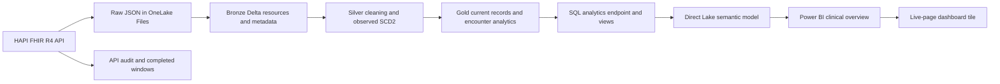

The pipeline runs Patient, Encounter, Observation, and Condition sequentially,
then executes the transformation stage. Each activity calls the same reusable
notebook with a different `resource_type` parameter. All dependencies require
success before the next activity can start.

| Deliverable | Saved Fabric item |
| --- | --- |
| Workspace | FHIR_Assignment_Pragati_Jha |
| Lakehouse | FHIR_Lakehouse |
| Notebook | FHIR_Medallion |
| Pipeline | FHIR_Incremental_Pipeline |
| Semantic model | FHIR_Analytics_Model |
| Report | FHIR_Clinical_Overview |
| Dashboard | FHIR_Clinical_Dashboard |

[Open workspace](https://app.fabric.microsoft.com/groups/9a1e4d7e-ae06-4011-b648-ccb54d690d3a/list?experience=power-bi)

Fabric links require an authorized Microsoft account and workspace access.
A public source repository does not grant access to the Fabric tenant.

## Deployment

1. Sign in to the intended giftzee.online Microsoft tenant. Use an existing
   Fabric-capable workspace and capacity. Creating a paid capacity is not part of
   this package.
2. Create a Lakehouse and import `notebooks/FHIR_Medallion.ipynb`. Attach the
   Lakehouse as its default. The code uses unqualified tables in the default
   schema, compatible with a schema-enabled Lakehouse's dbo default.
3. Confirm the notebook's first code cell is marked as the parameter cell.
   Set `start_date` and `end_date` to a three-day UTC range, exclusive end.
   Defaults use the three completed UTC days before execution.
4. Run the notebook with `resource_type=ALL` for a first complete load.
5. Create a Fabric Data Pipeline with five Notebook activities pointing to this
   same notebook. Chain them with Succeeded dependencies:
   Patient -> Encounter -> Observation -> Condition -> TRANSFORM.
   Pass `resource_type` for each activity and matching `start_date`, `end_date`
   pipeline parameters. `pipeline.template.json` is a deployment template with
   unresolved notebook/workspace IDs; validate its definition against Fabric
   before deploying. It is not a deployed pipeline.
6. On subsequent daily executions, pass yesterday's UTC start and today's UTC
   exclusive end. Replay a small overlap window to catch delayed updates.
   `ops_completed_windows` records complete resource windows; the caller chooses
   the next window. It is not an automatically advanced scheduler watermark.
7. After table synchronization, execute `sql/gold_views.sql` in the Lakehouse SQL
   analytics endpoint. These T-SQL views are persistent reporting objects.
8. Verify run history, API audit records, table counts, current-row invariants,
   and view queries in Fabric. Export screenshots and query results as execution
   evidence. A configured three-day backfill is distinct from three daily runs.

## Storage and lineage

- Raw: `Files/raw/<Resource>/date=YYYY-MM-DD/run=<UUID>/page-NNNNNN.json`.
  Response text is persisted before parsing or table conversion.
- Bronze: `bronze_patient`, `bronze_encounter`, `bronze_observation`,
  `bronze_condition`. Spark converts JSON resources to Delta records with the
  original resource JSON, source version, payload hash, API request URL,
  extraction/save timestamps, run ID, and raw-file pointer.
- Silver: corresponding `silver_*` Delta tables, cleaned and deduplicated,
  with selected typed analytics fields and SCD2 source-time validity intervals.
  Intervals are half open: valid_from <= time < valid_to; NULL end is current.
- Gold: corresponding `gold_*` current records and `gold_encounter_analytics`,
  which joins Encounter.patient_id to Patient.resource_id using a left join.
  Observation and Condition have patient_id and encounter_id relationships to
  the corresponding current tables. References are not enforced foreign keys.
- Ops: `ops_api_calls` logs page calls, persistence times, counts, failures, and
  raw locations. `ops_completed_windows` records fully persisted windows.

All layers retain metadata. Gold retains the selected current source version;
Silver retains observed change history. Gold and Silver processing timestamps
describe transformation time. Bronze Delta history provides table commit history.

## Correctness and operational boundaries

FHIR search uses repeated `_lastUpdated` parameters for inclusive lower and
exclusive upper bounds. Pagination follows Bundle `next` links verbatim,
restricted to the configured HTTPS endpoint. Retries honor throttling and a page
limit fails the window explicitly. Never treat a capped or failed run as complete.

Bronze merges deduplicate resource/version/hash, making repeated windows safe.
Raw and audit retain every attempt. Silver is recomputed from accumulated Bronze
to accommodate out-of-order observations. Unchanged payloads do not create new
SCD2 intervals. Conflicting payloads at the same source timestamp fail for manual
investigation rather than silently choosing a record. Only one pipeline writer
may run at a time; overwrites across multiple tables are not a single transaction.
Gold should be consumed only after the entire pipeline succeeds.

FHIR ordinary search returns the current matching resource, not every historic
version or deleted resource. History tracks versions this project actually
observes; a backfill cannot reconstruct versions overwritten before collection.
Capturing every source change requires a supported FHIR history/change feed.
No deletion detection is claimed. Public test-server data may change or contain
unresolved references. No sensitive production source is configured.

Patient demographics, Encounter class/period, Observation code/quantity, and
Condition code/status/onset are extracted. Non-quantity Observation values and
other FHIR polymorphic fields remain available in resource_json. Mixed units
must not be averaged without conversion. Contained/identifier-only references
remain unresolved. The optional Power BI report is implemented; no XML extension is included.

## Validation and further testing

- Completed: four resources across three UTC days, with multiple-page windows
  verified in the API audit query.
- Completed: successful pipeline replay, stable Gold counts, and new audit/raw
  attempt records. Bronze version/hash merges make the replay idempotent.
- Use controlled fixtures to validate A -> B -> A history, late arrivals, empty
  windows, HTTP failures, pagination failure, and conflicting source versions.
- Completed: SQL checked exactly one current row per resource ID, positive
  validity intervals, and no overlaps; zero invalid resources.
- Completed: pipeline ordering, successful status, SQL counts, report, and
  dashboard evidence captured. Controlled failure fixtures above remain additional
  regression testing; they are not claimed as executed.

## References

- Assignment source: D:/Downloads/Fabric Data Assignment - Pragati Jha.pdf
- FHIR source: https://hapi.fhir.org/baseR4/swagger-ui/
- Fabric notebooks: https://learn.microsoft.com/en-us/fabric/data-engineering/author-execute-notebook
- Notebook orchestration: https://learn.microsoft.com/en-us/fabric/data-engineering/notebookutils/notebookutils-notebook-run

Build/rebuild the notebook and submission ZIP with `python build_package.py`.

## Reporting model

`model.tmdl` defines five DAX measures and four Patient relationships. It was
applied to the saved Fabric Direct Lake semantic model. The report uses Gold
counts, Patient gender distribution, and Encounter class distribution. The
dashboard pins the full report page as a live tile. The automatically created
model includes Bronze/Silver/Ops tables too; report visuals use Gold tables.

## Parameters and execution

| Parameter | Default / example | Purpose |
| --- | --- | --- |
| `start_date` | Three days before current UTC date | Inclusive lower date boundary |
| `end_date` | Current UTC date | Exclusive upper date boundary |
| `resource_type` | `ALL` | ALL, Patient, Encounter, Observation, Condition, or TRANSFORM |
| `base_url` | `https://hapi.fhir.org/baseR4` | Configurable FHIR R4 endpoint |
| `page_size` | `200` | Requested resources per response page |
| `max_pages` | `10000` | Explicit pagination safety limit per window |

For the verified backfill, the parameters were `start_date=2026-10-13` and
`end_date=2026-10-16`. The code divides the range into three daily UTC windows.
The date filter is based on FHIR `meta.lastUpdated`, not encounter admission
or observation measurement dates.

Example notebook invocation after attaching the default Lakehouse:

```python
run(spark, "2026-10-13", "2026-10-16", "ALL",
    "https://hapi.fhir.org/baseR4", 200, 10000)
```

A resource request uses the following search shape:

```text
Patient?_lastUpdated=ge2026-10-13T00:00:00+00:00
       &_lastUpdated=lt2026-10-14T00:00:00+00:00
       &_count=200&_sort=_lastUpdated&_format=json
```

The HTTP client encodes the parameters. Subsequent pages follow the Bundle
`next` link. Same-host HTTP pagination links are upgraded to HTTPS; another
host or a path outside the configured FHIR base is rejected. Repeated next
links and exceeded page limits fail the window.

### Pipeline configuration

| Activity | Notebook parameter | Dependency |
| --- | --- | --- |
| Ingest_Patient | Patient | None |
| Ingest_Encounter | Encounter | Ingest_Patient succeeded |
| Ingest_Observation | Observation | Ingest_Encounter succeeded |
| Ingest_Condition | Condition | Ingest_Observation succeeded |
| Transform | TRANSFORM | Ingest_Condition succeeded |

Pipeline activities have a 12-hour timeout, two retries, and a 60-second retry
interval. The HTTP client separately retries transient statuses 429, 500, 502,
503, and 504 with backoff. These are distinct retry layers: one retries an HTTP
request; the other retries a complete notebook activity.

The deployed replay succeeded with run ID
`eaccad98-f94c-4264-960f-adc05ffd2c4e`. Trial compute limits caused transient
activity failures before retries recovered. There is no enabled daily schedule;
future executions require explicit date parameters and available capacity.

## Data dictionary

| Field | Meaning |
| --- | --- |
| resource_type | FHIR resource kind |
| resource_id | FHIR logical resource ID |
| version_id | Source meta.versionId |
| source_updated | Parsed source meta.lastUpdated |
| payload_hash | Hash used to distinguish observed payloads |
| resource_json | Complete individual resource JSON |
| extraction_timestamp | When the API resource was collected |
| saved_timestamp | Persistence timestamp |
| api_url_or_params | API request lineage |
| raw_path | Exact response file location |
| run_id | Ingestion attempt identifier |
| valid_from / valid_to | Half-open Silver SCD2 validity interval |
| is_current | Whether a Silver row is the current observed version |
| patient_id / encounter_id | IDs extracted from resolvable references |

Selected analytic fields include Patient gender and birth date; Encounter
class, status, and period; Observation code, effective time, quantity, and unit;
and Condition code, clinical status, and onset. Complete source resources remain
available for fields outside this selected projection.

### SCD2 processing

1. Read the accumulated Bronze versions and remove duplicate observations.
2. Validate that one source timestamp does not have conflicting payload hashes
   for the same logical resource.
3. Order observed versions by source update time.
4. Suppress consecutive versions with unchanged payload hashes.
5. Derive `valid_to` from the next retained version and mark the final one current.
6. Write Silver history and Gold current records, then validate current-row counts.

Recomputing from accumulated Bronze accommodates late-arriving observed
versions. A source sequence A → B → A retains all three changes because the final
A differs from its immediate predecessor. This behavior is part of the design;
controlled A/B/A fixture regression testing is not claimed as executed.

## Validation and results

The validated data window contains the following current Gold rows:

| Resource | Rows |
| --- | ---: |
| Patient | 726 |
| Encounter | 3,761 |
| Observation | 1,726 |
| Condition | 1,853 |
| Total across resource tables | 8,066 |

The total is a sum across resource kinds, not a count of unique patients.
`sql/validation.sql` contains the exact validation queries. The SCD2 query found
**0 invalid resources**, checking exactly one current row, positive closed
intervals, and no overlapping validity periods.

| Check | Observed result |
| --- | --- |
| Initial three-day notebook backfill | Succeeded |
| Pipeline definition validation | No errors found |
| Five-stage pipeline replay | Succeeded |
| Completed resource/day windows | 12 |
| Multi-page extraction | Verified, up to 18 pages in a window |
| SQL reporting views | Created successfully |
| Gold counts after replay | Matched the verified counts above |
| SCD2 invalid-resource count | 0 |
| Report and live dashboard | Saved and visually verified |

The latest successful resource/day attempts total 47 response pages. Detailed
per-day counts are in [api-windows.csv](evidence/api-windows.csv). These are
response-page counts for committed attempts, not all retry traffic or every
historical API call.

### DAX measures and report layout

```dax
Patients = COUNTROWS(gold_patient)
Encounters = COUNTROWS(gold_encounter)
Observations = COUNTROWS(gold_observation)
Conditions = COUNTROWS(gold_condition)
Encounters per Patient = DIVIDE([Encounters], [Patients])
```

The model relates each Gold resource's `patient_id` to
`gold_patient.resource_id`; encounter analytics has the same Patient relationship.
The applied relationships and measures are preserved in `model.tmdl`.

The 1280 × 720 report page contains a title, four KPI cards, a Patient gender
donut, and an Encounter class bar chart. Card display units abbreviate some
counts as K; the exact counts are recorded above. Unknown and missing gender
values remain visible rather than being silently removed.

| Patient gender | Count |
| --- | ---: |
| Missing / blank | 279 |
| Female | 216 |
| Male | 206 |
| Unknown | 18 |
| Other | 7 |

| Encounter class | Count |
| --- | ---: |
| AMB | 3,521 |
| IMP | 122 |
| EMER | 90 |
| NONAC | 11 |
| HH | 7 |
| VR | 6 |
| Missing / blank | 4 |

The dashboard pins the whole report page as a live tile. After successful data
processing, refresh the model/visuals as needed to see updated values. The
repository includes model definitions and screenshots; it does not contain a
standalone exported PBIX or PBIP report package.

## Screenshot gallery

Screenshots document the actual Fabric and Power BI work. Account signup and
credential screens are excluded from the project evidence.

### Fabric workspace

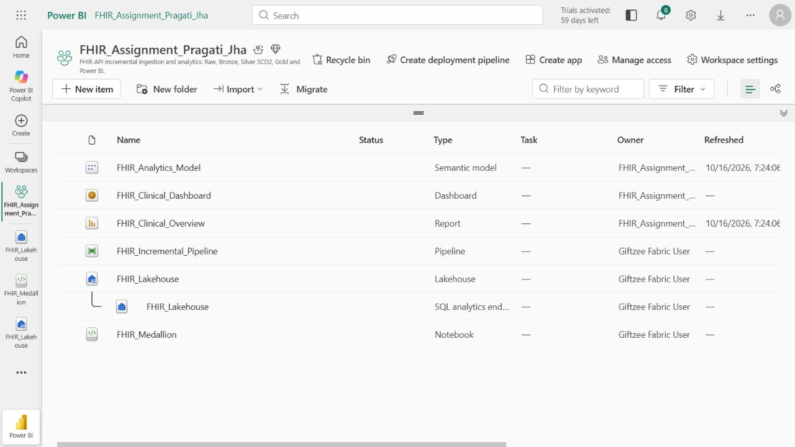

### Fabric lineage

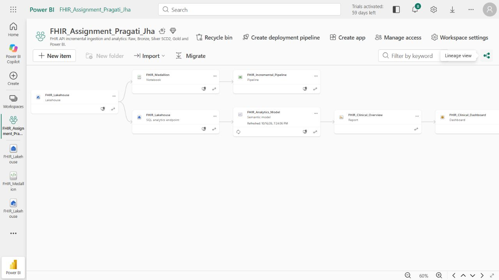

### Successful backfill

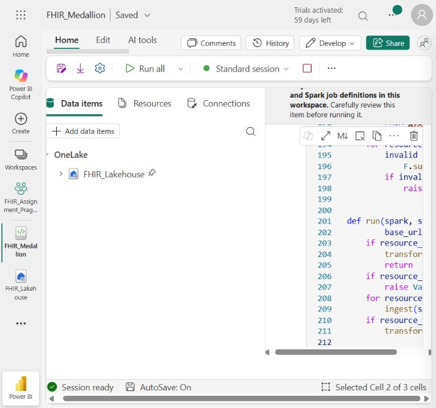

### Pipeline validation

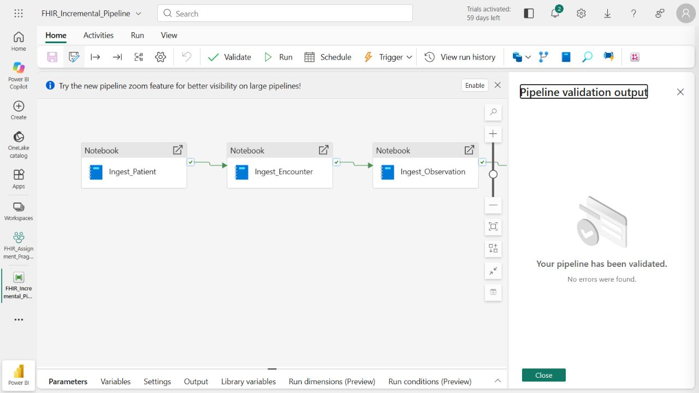

### Successful pipeline execution

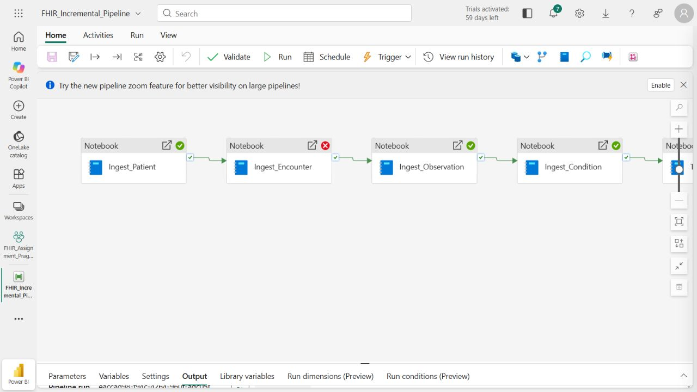

### SQL Gold counts

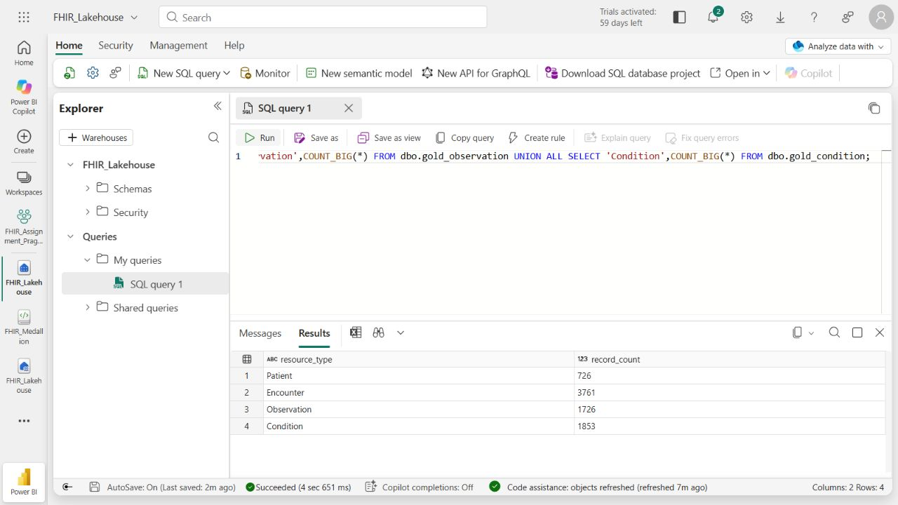

### API pagination audit

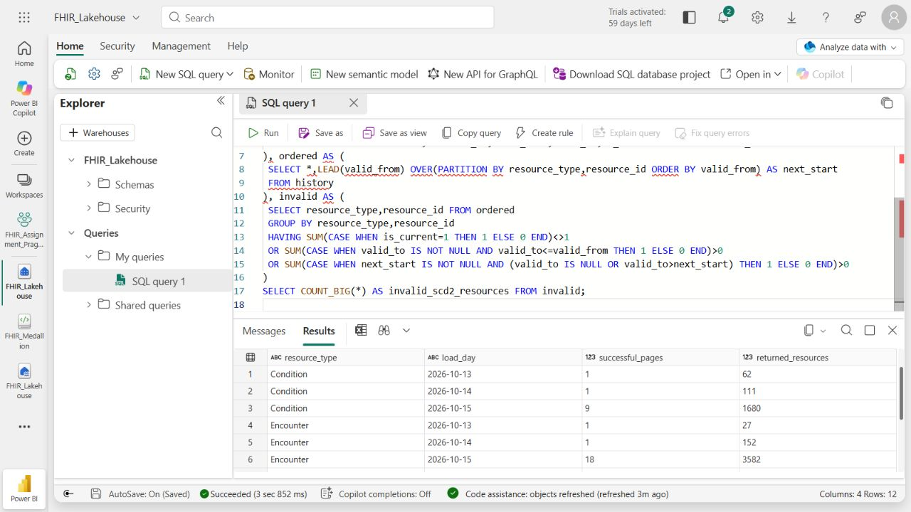

### SCD2 validation

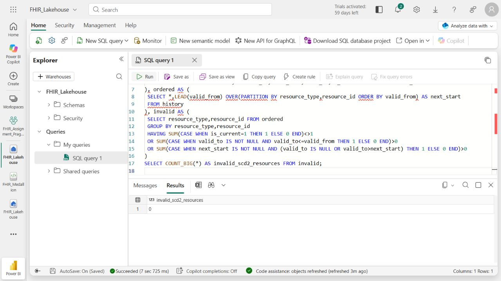

### Power BI report

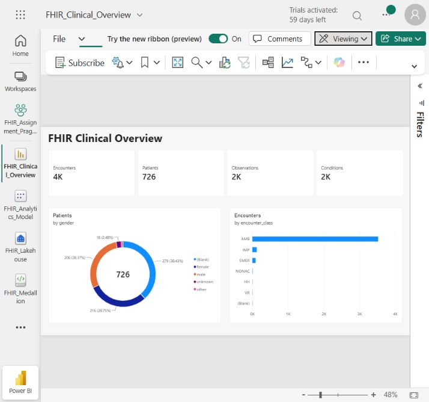

### Power BI dashboard

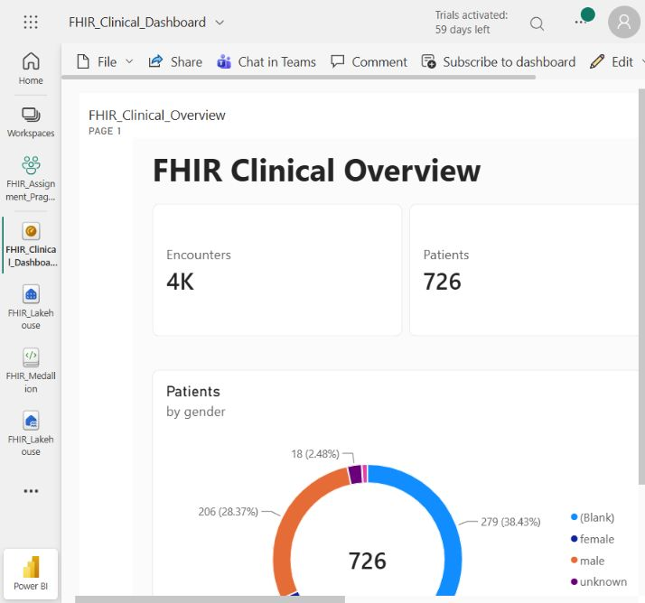

## Operations and troubleshooting

| Situation | Action |
| --- | --- |
| Notebook cannot resolve files or tables | Attach FHIR_Lakehouse as the default Lakehouse and confirm the default schema |
| Trial Spark compute limit | Stop unused interactive sessions, allow retries, and inspect final pipeline status |
| SQL endpoint does not show new tables | Synchronize Lakehouse metadata and rerun the SQL query |
| HTTP throttling or transient server error | Inspect API audit, allow configured retries, and replay only complete intended windows |
| Pagination loop, unexpected host, or page cap | Investigate the source links; do not mark the incomplete window successful |
| Conflicting payloads at identical source time | Inspect Bronze lineage and resolve the source conflict before transforming again |
| Stale report visuals | Confirm the full pipeline succeeded, then refresh the semantic model/visuals |
| Need the next daily increment | Pass yesterday's UTC start and today's exclusive UTC end; use overlap for delayed updates |

Keep a single pipeline writer. Transform overwrites are not a transaction across
all tables, so a partially failed transformation must be rerun before consumers
use the refreshed Gold data. The current implementation is appropriate for this
assignment-sized source; it recomputes history from Bronze and is not a tuned
large-scale streaming system.

## Repository guide

```text
README.md                       Architecture, setup, results, screenshot gallery
src/fhir_medallion.py            Reusable Fabric PySpark implementation
notebooks/FHIR_Medallion.ipynb   Importable notebook with parameter cell
pipeline.template.json          Five-activity parameterized pipeline template
model.tmdl                      Applied DAX measures and relationships
sql/gold_views.sql              Persistent reporting view definitions
sql/validation.sql              Counts, API window audit, SCD2 checks
deployment-status.json          Verified cloud item IDs and execution state
evidence/                       Fabric/Power BI screenshots and query results
build_package.py                Notebook and submission archive builder
fabric-fhir-project.zip         Complete downloadable submission archive
```

To rebuild locally from the project directory:

```bash
python build_package.py
```

The script validates Python syntax, regenerates the notebook and pipeline
template, and writes the ZIP beside the project directory. Spark execution
requires Microsoft Fabric and an attached default Lakehouse; ordinary local
Python alone cannot execute this workflow. Replace template workspace/notebook
placeholders with the destination IDs before deploying elsewhere.

## Scope and reproducibility

The source is a public HAPI FHIR test server. Counts describe the verified run,
not a promise that a later public-server query returns identical data. Clinical
chart categories are source values, not medical conclusions. Optional XML
archiving, source deletion capture, a production history feed, recurring scheduling,
and controlled failure-fixture tests are outside the completed implementation.
No passwords, tokens, or account-setup screenshots are included.

